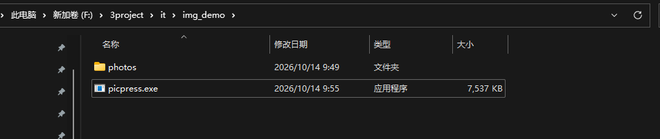

# picpress — Offline Batch Image Compressor CLI (Windows)

[中文](README.zh-CN.md) · **English**

Drop your images into a folder, compress them in bulk with a single command, optionally exporting the **original format / WebP / AVIF**, with an automatic log file.

- **No setup**: a single `picpress.exe` — copy it to any Windows machine and run. No Node / Python / .NET required, only system DLLs.
- **Small**: about 7.4 MB.
- **Concurrent**: processes images in parallel using all CPU cores by default; one failing image never aborts the whole batch.
- **Visually lossless first**: keeps the original resolution by default; resizing is an opt-in switch.

Supported inputs: `jpg/jpeg`, `png`, `webp`, `gif`, `tif/tiff`, `bmp` (subdirectories are scanned recursively).

> `heic/heif` (the iPhone default), RAW and other camera-specific formats are **not** supported yet; such files are skipped automatically.

## Download

- Gitee primary repository Releases: `https://gitee.com/miaoaa66/compress-pictures/releases` — download `picpress.exe` directly.
- The downloaded exe is all you need: a **portable app, no installation required**. Put it in any folder — **double-clicking** it starts an interactive mode that asks for the folders and the format, and you can also run it from the command line with arguments (see below). To uninstall, just delete the file.
- Requirements: Windows 10 / 11 64-bit. The target machine needs no Rust, Node, Python, .NET or any other runtime.

## Quick start

Drop the images to compress into the `photos` folder, then run from the project root (`picpress.exe` sits in the current directory, so the leading `.\` is required). The output directory `out` is created automatically if missing:

Run ```picpress.exe``` in the project root, or execute one of the commands below on the command line:

```powershell

# WebP (recommended; usually 25%-35% smaller than JPEG at the same quality)
.\picpress.exe -i .\photos -o .\out -f webp

# AVIF (even smaller, but slower to encode)
.\picpress.exe -i .\photos -o .\out -f avif

# Re-compress in the original format (JPEG re-encode, PNG lossless optimization)
.\picpress.exe -i .\photos -o .\out -f original

# Without -f it prompts interactively (Enter defaults to webp)
.\picpress.exe -i .\photos -o .\out

# With no arguments at all (same as double-clicking the exe) → interactive mode,
# asking for the input folder, output folder and format in turn
.\picpress.exe
```

> `.\` is a PowerShell safety rule: a command that is not on PATH must be given as a relative or absolute path. To type `picpress` from any directory, add the folder containing `picpress.exe` to your PATH.

> **In cmd**: the command is written the same way, `.\picpress.exe` works directly. If the Chinese output shows as garbled text, run `chcp 65001` once to switch to the UTF-8 code page.

When it finishes, the log shows a per-file breakdown and a summary:

```
[1/6] synthetic.png  3000x2000  PNG → WebP  5.45 MB → 61.7 KB  +98.9%  436ms
[2/6] 03.jpg  5000x3300  JPEG → WebP  1.73 MB → 1.81 MB  -4.4%  1612ms
[5/6] 02.jpg  7000x4170  JPEG → WebP  4.50 MB → 1.49 MB  +66.8%  2472ms
[6/6] 01.jpg  7000x4667  JPEG → WebP  4.45 MB → 1.30 MB  +70.8%  2535ms
──────── Summary ────────
Files: 6 succeeded · 0 failed · 6 total
Size:  20.40 MB → 9.41 MB  (+53.9%)
Time:  2.5 s
```

The log file is written to `logs\compress-<date>-<time>.log` in the current directory, and is also printed to the console.

Log fields, from left to right: index, file name, dimensions, `input format → output format`, original size, compressed size, compression ratio, elapsed time. A positive ratio means the file got smaller (e.g. `+92.9%` means 92.9% saved); a negative one means it grew after compression.

## Options

| Option | Description |
| --- | --- |
| `-i, --input <DIR>` | Input directory, scanned recursively; omit it to be prompted |
| `-o, --output <DIR>` | Output directory; the relative structure of the input is preserved by default; omit it to be prompted |
| `-f, --format <F>` | Output format: `original` / `webp` / `avif`; omit it for an interactive prompt |
| `--preset <P>` | Quality preset: `high` / `medium` (default) / `small` |
| `--quality <1-100>` | Set quality manually, overriding the preset (AVIF uses the same 1-100 scale) |
| `--resize <N>` | Scale down so the long edge is N pixels (never upscales); default is no resize, original resolution kept |
| `--jobs <N>` | Number of concurrent threads; defaults to the CPU core count |
| `--keep-exif` | Keep EXIF (JPEG output only); all metadata is stripped by default |
| `--flatten` | Do not preserve the relative directory structure — flatten everything into the output directory |

Quality values behind each preset:

| Preset | JPEG / WebP | AVIF | PNG optimization level |
| --- | --- | --- | --- |
| `high` | 88 | 65 | 3 |
| `medium` | 80 | 58 | 4 |
| `small` | 70 | 50 | 6 |

Notes:

- The output extension follows the format: `webp` → `.webp`, `avif` → `.avif`, and `original` follows the input type (`jpg` / `png` / `webp`).
- Phone photos are automatically corrected for EXIF orientation before encoding, so the picture is upright; with `--keep-exif` the orientation tag is reset to 1 to avoid a double rotation.
- If an image grows after compression (common for small images that were already heavily compressed), the log honestly records a negative compression ratio.

## FAQ

**The file got bigger after compression?**
Common for small images that were already compressed (e.g. downloaded from the web). Lower the quality (`--quality 60`) or add `--resize` to limit the long edge.

**The AVIF file won't open?**
AVIF is a newer format and some built-in viewers do not support it. You can open it in a recent version of Chrome / Edge, install the *AV1 Video Extension* from the Microsoft Store, or use a third-party viewer that supports AVIF, such as [GuoheView](https://pic.ghxi.com/zh/) or [Bandiview](https://www.bandisoft.com/bandiview/).

**My HEIC photos were not processed?**
HEIC (the iPhone default) is not supported yet; such files are skipped automatically. Set your phone camera to "Most Compatible" (outputs JPEG), or convert the files to JPEG with another tool first.

**Chinese text is garbled in cmd?**
Run `chcp 65001` to switch to the UTF-8 code page, then run the command.

**Large images are slow / use a lot of memory?**
A 9000×13500 image can take several hundred MB of memory once decoded. If memory is tight, lower concurrency with `--jobs 2`; to shrink size fast, add `--resize 3000`.

**Is the compiled `target/` directory huge?**
`target/` is only a build cache, not a deliverable: it is covered by `.gitignore` and the only thing shipped is the ~7.4 MB `picpress.exe`. A new set of artifacts is added only when the build fingerprint changes, and cargo never garbage-collects the old ones — editing code does not accumulate anything, but after you change a profile in `Cargo.toml` (`opt-level`, `debug`, `lto`, …), `RUSTFLAGS`, dependency versions, or the rustc version, the previous artifacts stay on disk and the directory can grow to several GB.

To reclaim the space, delete `target/` and rebuild:

```powershell
Remove-Item .\target -Recurse -Force
.\build.ps1
```

If `cargo` is not on your PATH (typing `cargo` gives "The term 'cargo' is not recognized…"), use the full path instead: `& "$env:USERPROFILE\.cargo\bin\cargo.exe" clean`. `build.ps1` already uses that full path internally, so building is unaffected by PATH.

## Benchmarks (`medium` preset, original resolution kept)

> Test environment: Windows 64-bit, 12-thread CPU. Elapsed times depend on image content and disk speed and are indicative only.

| Source | Input size | Output | Output size | Compression | Tested by |
| --- | --- | --- | --- | --- | --- |
| forest.jpg 9000×5994 | 14.75 MB | WebP | 4.08 MB | -72.4% | ai |
| city.jpg 9000×13500 | 20.95 MB | WebP | 4.71 MB | -77.5% | ai |
| city.jpg + `--resize 3000` | 20.95 MB | WebP 2000×3000 | 635 KB | -97.0% | ai |
| forest.jpg | 14.75 MB | JPEG (original) | 5.07 MB | -65.6% | ai |
| city.jpg | 20.95 MB | JPEG (original) | 6.26 MB | -70.1% | ai |
| 04.jpg 5000×3300 | 2.53 MB | AVIF | 1.48 MB | -41.6% | ai |
| 10m.jpg | 9.55 MB | jpg | 816 KB | -91.66% | author |
| 10m.jpg | 9.55 MB | WebP | 695 KB | -92.9% | author |
| 10m.jpg | 9.55 MB | AVIF | 337 KB | -96.6% | author |

> Resizing is the real driver of size reduction: with `--resize`, 10-20 MB photos drop straight to a few hundred KB with virtually no visible loss.

## Project layout

| Path | Description |
| --- | --- |
| `src/main.rs` | CLI entry: argument parsing, interactive prompt, summary output |
| `src/walker.rs` | Recursively scans the input directory and filters supported images |
| `src/codec.rs` | Codec core: decode, resize, EXIF orientation, JPEG/PNG/WebP/AVIF encoding |
| `src/pipeline.rs` | rayon concurrency; keeps the batch going when a single image fails |
| `src/logger.rs` | Writes the log to `logs/compress-<timestamp>.log` |
| `.cargo/config.toml` | Static linking config (`crt-static` / `link-self-contained`) |
| `build.ps1` | One-shot build script |

## Building from source (build machine only)

The build machine needs: Rust (with the `x86_64-pc-windows-gnu` target), MinGW-w64's gcc (to compile the C dependencies such as mozjpeg / libwebp), and nasm (for rav1e's x86_64 SIMD assembly).
The target machine needs nothing.

```powershell
.\build.ps1
# Output: target\release\picpress.exe
# A copy is also placed in the project root as picpress.exe, ready for the Quick start commands above
```

By default gcc is looked up in `C:\devtools\w64devkit\bin` and nasm in `C:\devtools\nasm\Library\bin`; override them with the `MINGW_BIN` / `NASM_BIN` environment variables.

> Note: releases must use `opt-level = 3`. `-Oz/-Os` triggers corrupted Huffman tables in mozjpeg's progressive encoding (`JERR_HUFF_MISSING_CODE`) and writes into invalid memory, crashing the process. See [Cargo.toml](Cargo.toml).

---

## ⚠️ Repository notice

The **primary repository of this project is on Gitee**; GitHub is a read-only mirror that is synced automatically, one direction only.

1. You are free to fork this copy of the code on GitHub, but all code commits, bug reports, feature requests and pull requests should go to the Gitee primary repository.
2. Every file in this GitHub repository is overwritten by the automatic sync from Gitee — any manual change made here will be lost.

👉 Gitee primary repository: `https://gitee.com/miaoaa66/compress-pictures`

---

## 📄 License

This project is released under the [MIT License](./LICENSE), Copyright (c) 2026 Miaoaa.
